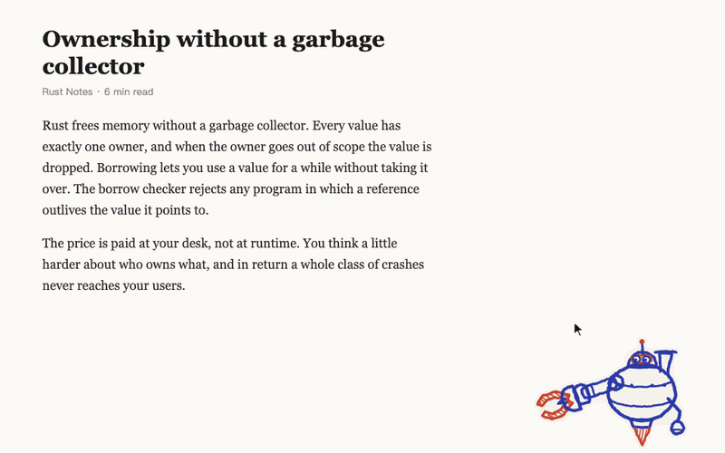
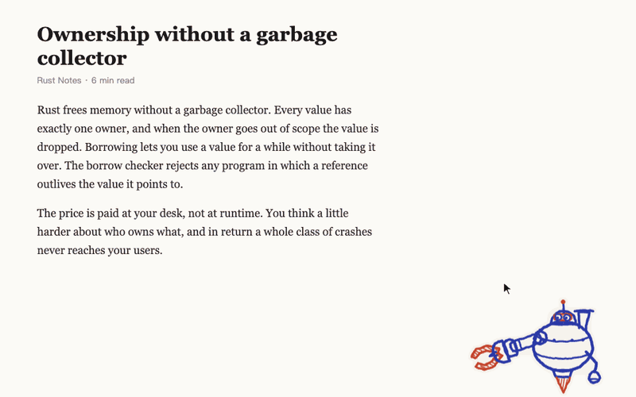
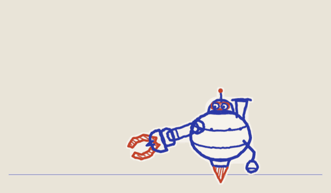
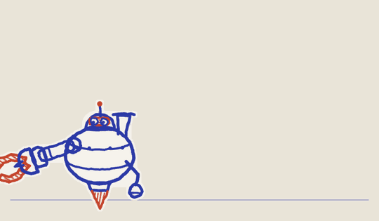

# Blitz Boy

**English** | [中文](README.zh-CN.md)

A pen-hatched Blitzcrank who lives on your macOS desktop. Point at any sentence on screen and he hooks it back, then explains it in a thought bubble above his head, taking the surrounding context into account.


https://github.com/user-attachments/assets/1b2523f6-3937-454e-80dd-0217b19cf739


<p align="center">
  
  
</p>
<p align="center">
  
  
  
  
</p>

- **Grab anything**: web pages, PDFs, editors, terminals, chat windows, even text inside a video frame.
- **Tap for a sentence, hold for a paragraph**: hold to charge, and when the ring fills he grabs the whole paragraph.
- **Reads the context**: the explanation also looks at the app, the window title and the surrounding text.
- **A proper desk pet**: he watches your cursor, waves and puffs steam. Pick him up and shake him, throw him and he bounces off the walls. Leave him alone and he drifts around the screen like an old DVD screensaver. When he's bored he listens to music, DJs, plays guitar or violin, sings, or doodles on an easel.

## Requirements

| | |
|---|---|
| System | **macOS 13 Ventura or later** (Mac only: grabbing text relies on macOS Accessibility and Vision text recognition) |
| Chip | Apple Silicon and Intel, download the matching build |
| Claude Code | Installed and logged in. Explanations come from your local `claude -p` (see "Model settings"). Without it the hook and the idle animations still work, there's just no explanation |

## Install

1. Download a build from [Releases](https://github.com/Aeriths1/blitz-pet/releases/latest): `arm64` for M-series chips, `x64` for Intel.
2. Open the DMG and drag Blitz Boy into Applications.
3. If macOS blocks the first launch, go to **System Settings › Privacy & Security**, scroll to the bottom and click "Open Anyway".

### Run from source

Requires Node.js 18+ and the Xcode Command Line Tools (`xcode-select --install`).

```bash
git clone https://github.com/Aeriths1/blitz-pet.git blitz-pet
```

```bash
cd blitz-pet && npm install
```

```bash
npm run build:native
```

```bash
npm start
```

To build the DMG yourself: `npm run dist`, output in `dist/`.

## Permissions

In **System Settings › Privacy & Security**, give two permissions to the app running Blitz: **Blitz Boy** if you installed the DMG, or **Electron** (`node_modules/electron/dist/Electron.app`) when running with `npm start`.

| Permission | Used for | Without it |
|---|---|---|
| **Accessibility** | Reading the original text under the pointer, its position and the text around it | Falls back to reading the screen, a bit slower and with the odd typo |
| **Screen & System Audio Recording** | Reading text from the screen (video frames, images, apps that don't expose their text) | Only apps that expose their text can be grabbed |

With neither, Blitz grabs whatever text is on the clipboard. Restart Blitz after granting permissions.

## Model settings

Explanations go through your local Claude Code (`claude -p`), using your own Claude Code login and usage. No API key needed. The defaults live in **`config.json`** at the project root. With the DMG installed, put the settings you want to change in **`~/Library/Application Support/Blitz Boy/config.json`** (only the keys you change; they override the defaults, and this also works when running from source):

```json
{
  "model": "claude-opus-5-5",
  "effort": "low",
  "claudeBin": "",
  "configDir": ""
}
```

| Key | Meaning | Values |
|---|---|---|
| `model` | Model used for explanations | `claude-opus-5-5` (default, strongest), `claude-sonnet-5-5` (faster), `claude-haiku-5-5` (fastest, cheapest) |
| `effort` | How hard it thinks; higher is slower | `low` (default), `medium`, `high` |
| `claudeBin` | Path to the Claude Code executable; found automatically when empty | e.g. `/opt/homebrew/bin/claude` |
| `configDir` | A Claude Code config directory just for Blitz, holding its own login, so it can use a different account from your terminal; empty shares the terminal's login | Empty by default |

- Changes take effect on the next hook, no restart needed.
- When `claudeBin` is empty, Blitz looks in this order: the CLI bundled with the Claude desktop app → `~/.local/bin/claude` → `/opt/homebrew/bin/claude` → `/usr/local/bin/claude` → `claude` on `PATH`.
- To give Blitz its own account, set `configDir` to e.g. `~/.claude-blitz` and log in once for Blitz: run `CLAUDE_CONFIG_DIR=~/.claude-blitz claude` in a terminal, type `/login`, log in with the account Blitz should use, then quit. Your usual `claude` in the terminal is unaffected.
- Environment variables override `config.json`: `BLITZ_MODEL`, `BLITZ_EFFORT`, `CLAUDE_BIN`, `BLITZ_CLAUDE_CONFIG_DIR`. For example, to try another model once:

```bash
BLITZ_MODEL=claude-haiku-5-5 npm start
```

- The call loads none of your hooks, plugins, MCP servers, CLAUDE.md or tools; only the prompt is sent.
- If macOS has a system proxy and your terminal doesn't, Blitz uses the system proxy.

### What gets sent to the model

| Content | Source |
|---|---|
| The grabbed sentence or paragraph | Under the pointer |
| Context | The full article text for web pages; about 2,000 characters on each side for plain text; the text of the same window when reading the screen. Centered on the sentence, about 6,000 characters at most |
| App name and window title | The window under the pointer |

The screenshot is taken only while aiming, deleted right after the text is read, and never saved.

## Usage

| Action | Result |
|---|---|
| Click Blitz, or press **⌥Q** | Aim: a lane runs from his arm to your cursor, and the sentence under it gets red hatching |
| **Tap** while aiming | Fire the hook and grab that sentence |
| **Hold about half a second** while aiming | Charge; when the ring fills he grabs the whole paragraph |
| **Esc** or **right-click** while aiming | Put the hook away |
| **Copy** / **✕** in the bubble | Copy the explanation / close the bubble |
| Drag Blitz | Pick him up; let go to throw him, he bounces off the walls and lands |
| Hover over Blitz | He looks at you and waves; stay longer and he spins his antenna and puffs steam |
| Right-click Blitz | His own menu: idle animations, accessories, and the language (follows your system; switch between English and Chinese here, explanations follow it too) |
| Blitz ignored for 45 seconds (cursor hasn't touched him) | He doodles or plays a little idle animation where he stands |
| Computer idle for 5 minutes (no keyboard or mouse) | Only then does he wander: flies around the screen (celebrates when he hits a corner), plays a jumping game, dashes, strolls along the bottom of the screen. Touch him with the cursor and he drops back down |

### Menu bar

The menu bar menu is in Chinese; the English meaning is given here.

| Menu item | What it does |
|---|---|
| 隐藏 / 显示 Blitz Boy (Hide / Show, **⌃⇧H**) | Hide him or bring him back |
| 出钩抓一句 (Hook a sentence, **⌥Q**) | Start aiming |
| 回到右下角 (Back to the corner) | Drop him back to the bottom-right corner |
| 待机时自己玩 (Play on his own when idle) | Toggle drifting and jumping when idle |
| 现在就飘 (Drift now) | Take off right away |
| 玩 Doodle Jump (Play Doodle Jump) | Steer with the mouse, Esc to stop |
| 看他自己跳 (Watch him play) | He plays a round by himself |
| 待机动画 (Idle animations) | Play one on demand: music, DJ, guitar, singing, violin, doodling and more |
| 装饰 (Accessories) | Headphones and sunglasses, each on its own checkbox |
| 退出 (Quit) | Quit Blitz |

Press **⌃⇧E** for his entrance: he rises from the bottom of the screen wearing sunglasses.

## How text is grabbed

In this order, until one works:

1. **Accessibility** (`native/ax-at`): reads the app's original text and the position of every character, in about 0.1 s. Works with native text, Safari, Chrome and Electron apps (Obsidian, VS Code, Cursor).
2. **Reading the screen** (`native/ocr`, Apple Vision): used when the original text isn't available, e.g. text in videos, images, paragraphs broken across lines in PDFs. A full-screen read takes about 0.8 s; the first run loads the recognition model and is slower.
3. **Clipboard**: used when neither permission is granted.

Electron apps and Chrome don't expose web page text by default; Blitz switches on their accessibility mode when grabbing (the same as when VoiceOver is on).

## Layout

```
main.cjs            Transparent window, menu bar, shortcuts, screenshots, grabbing text, calling the model
preload.cjs         Bridge between the page and the main process
index.html          Styles and the thought bubble
config.json         Model settings
src/blitz.mjs       Behavior, the hook, drawing
src/acts.mjs        Idle animations
src/text.mjs        Joining and splitting screen-read text into sentences
src/claude.cjs      Calling Claude Code
src/pen.mjs         Hatched pen strokes
src/sound.mjs       Hook sounds (fire, charge)
native/ax-at.swift  Grabbing text via Accessibility
native/ocr.swift    Reading the screen with Vision
assets/             Blitz's SVG parts, menu bar icon and sounds
```

## Disclaimer

Blitzcrank is a character from Riot Games' League of Legends. This is an unofficial fan project, not affiliated with or endorsed by Riot Games, free and non-commercial. Blitz's pen-hatched art is original to this project.

The sounds in `assets/sfx/` are original to this project, layered from synthesized effects made with the code of [earshot](https://github.com/Leonxlnx/earshot) (MIT). They contain no recordings or game audio; sources are in `assets/sfx/SOURCES.md`.

## License

The code, original artwork and sounds are released under the [MIT](LICENSE) license. The Blitzcrank character is not covered by the license and is the property of Riot Games.
